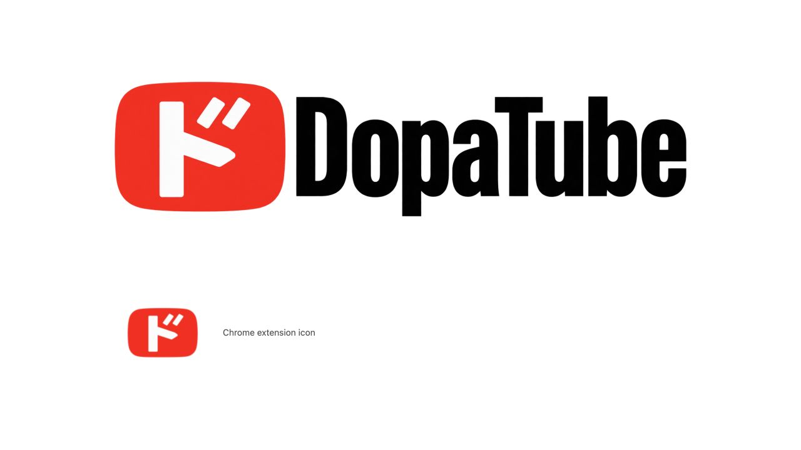

# DopaTube

A Chrome extension that lets you change YouTube playback speed with a single click from the header.



## Features

- Adds a playback speed button between the YouTube logo and the search box.
- Cycles through **1.0× → 1.5× → 2.0× → 1.0×** with each click.
- Keeps the selected speed when switching videos within the same page.
- Adjusts the button's position as the window resizes. If there is not enough space, the button appears next to the logo.

Works on `https://www.youtube.com/` in desktop Chrome.

## Installation

Install [DopaTube from the Chrome Web Store](https://chromewebstore.google.com/detail/dopatube/kjaphodjmimipehdghlmcpecnchfcoii), then open YouTube. If YouTube is already open, reload the page.

## Usage

Click the numbered button in the YouTube header.
The number displayed is the playback speed applied to videos on that page.

The default speed is `1.0×`. Reloading the page or opening a new tab resets the speed to `1.0×`.
Each tab maintains its own selection. Speed preferences are neither saved nor synced across tabs.

YouTube's built-in speed controls also work. DopaTube displays the speed you select, including values such as `1.25×`.
The next click selects the next higher speed among `1.0×`, `1.5×`, and `2.0×`, wrapping to `1.0×` at `2.0×` or above.

## Privacy and Site Access

DopaTube does not collect, store, or transmit personal information, watch history, or search history.
It does not use analytics or communicate with external servers.

The content script runs only on `https://www.youtube.com/*` to add the header button and change video playback speed.
No additional `permissions` or `host_permissions` are declared.

See the [Privacy Policy](PRIVACY.md) for details.

## Development

Built with Manifest V3 and HTML, CSS, and JavaScript.
No dependency installation or build step is required.

### Install from source

1. Download and extract this repository, or clone it:

   ```sh
   git clone https://github.com/yatmsu/dopatube.git
   ```

2. Open `chrome://extensions` in Chrome.
3. Enable **Developer mode** in the top-right corner.
4. Click **Load unpacked**.
5. Select the `dopatube` folder containing `manifest.json`.
6. Open YouTube. If it is already open, reload the page.

### Reload after changes

After editing files, click the reload button for DopaTube at `chrome://extensions`, then reload the YouTube page.
Close and reopen the popup to see changes to it.

## Support

Report bugs and suggest features through [GitHub Issues](https://github.com/yatmsu/dopatube/issues).
For bug reports, include your Chrome version, steps to reproduce the issue, and the expected and actual behavior.

## License

[MIT License](LICENSE)
